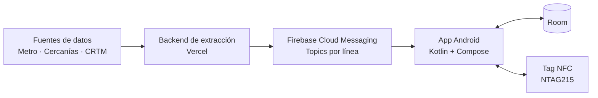
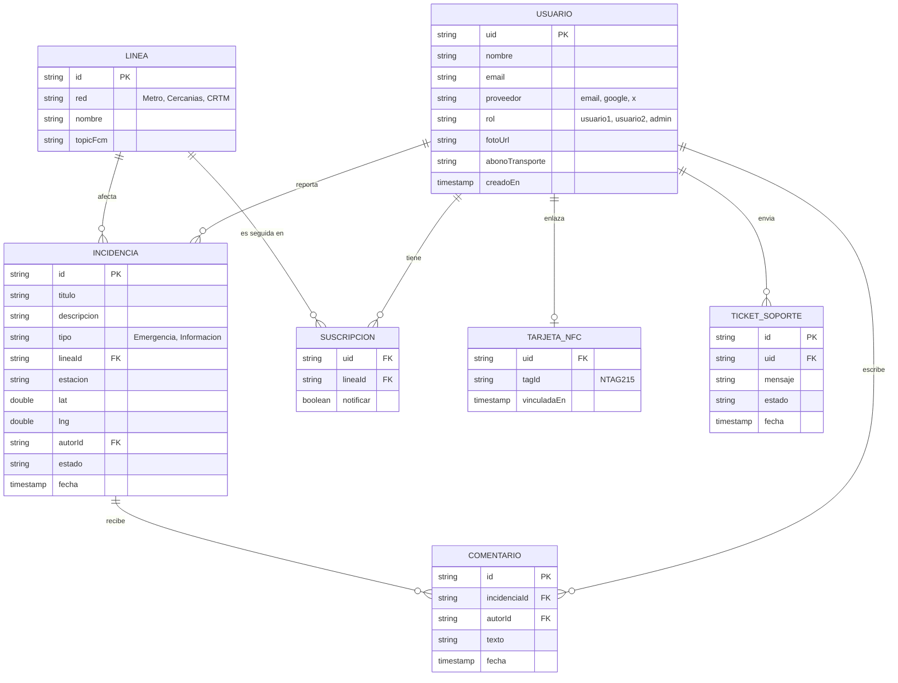

<p align="center">
  
</p>

<p align="center">
  <b>Anticípate a las incidencias de tu transporte público. Antes de llegar a la estación.</b>
</p>

<p align="center">
  
  
  
  
  
  
  
  
</p>

<p align="center">
  <a href="LICENSE"></a>
  
  
  <a href="https://github.com/ag-hp/tranzit/actions/workflows/build.yml">
    
  </a>
</p>

<p align="center">
  
</p>

## Índice

1. [Descripción](#1-descripción)
2. [Características](#2-características)
3. [Capturas de pantalla](#3-capturas-de-pantalla)
4. [Arquitectura](#4-arquitectura)
5. [Base de datos](#5-base-de-datos)
6. [Tecnologías](#6-tecnologías)
7. [Instalación y ejecución](#7-instalación-y-ejecución)
8. [Estructura del proyecto](#8-estructura-del-proyecto)
9. [Autor](#9-autor)
10. [Licencia](#10-licencia)

---

## 1. Descripción

**TRANZIT** es una aplicación móvil nativa para Android orientada a la **anticipación de incidencias** en redes de transporte público (**Metro, Cercanías y CRTM**).

Su objetivo es avisar al usuario **antes** de que llegue a la estación. Para ello combina un backend ligero de extracción de datos con notificaciones push segmentadas por líneas (*Firebase FCM Topics*). Además, integra lectura y escritura **NFC (NTAG215)** para consultar estados de forma física.

---

## 2. Características

- 🔔 **Alertas push por línea**: suscripción a las líneas que usas mediante FCM Topics.
- 🚇 **Cobertura multi-red**: Metro, Cercanías y CRTM.
- 📲 **NFC (NTAG215)**: lectura y escritura de tags para consultar el estado de una línea o estación.
- 🗄️ **Persistencia local** con Room.
- ☁️ **Backend ligero** de extracción de datos desplegado en Vercel.
- <!-- Añade aquí nuevas características -->

---

## 3. Capturas de pantalla

> _Próximamente._

<!--
<p align="center">
  
  
  
</p>
-->

---

## 4. Arquitectura



> _Aquí puedes ampliar con detalles de capas, patrones y decisiones técnicas._

---

## 5. Base de datos

La base de datos en la nube se apoya en **Firebase (Cloud Firestore)**, y la app guarda una copia local con **Room** para consultar datos sin conexión. La estructura sale directamente de las pantallas del diseño: registro, foro de comunidad, mapa, contacto y soporte, y perfil.

### 5.1 Perfiles de usuario

Cada cuenta tiene un campo `rol` que determina lo que puede hacer en la app.

| Rol | Descripción | Permisos |
|---|---|---|
| `usuario1` | _Por definir_ | Registro, consulta de incidencias, foro, mapa, perfil propio |
| `usuario2` | _Por definir_ | _Por definir_ |
| `admin` | Administrador de la app | Moderar incidencias y comentarios, gestionar usuarios, responder tickets de soporte, editar FAQ y líneas |

### 5.2 Modelo entidad-relación



### 5.3 Colecciones y pantallas

| Colección | Pantalla que la usa |
|---|---|
| `usuarios` | Registro, Perfil |
| `lineas` | Foro, Mapa, Notificaciones |
| `incidencias` | Foro (Comunidad), Mapa, Historial de reportes |
| `comentarios` | Foro |
| `suscripciones` | Perfil (Notificaciones), alertas push (FCM Topics) |
| `tarjetas_nfc` | Perfil (Enlazar tarjeta NFC) |
| `tickets_soporte` | Contacto y Soporte |
| `faq` | Contacto y Soporte (Preguntas frecuentes) |

> _Aquí puedes ampliar con reglas de seguridad de Firestore e índices._

---

## 6. Tecnologías

| Área | Tecnología |
|---|---|
| Lenguaje | Kotlin |
| UI | Jetpack Compose |
| IDE / Build | Android Studio · Gradle |
| Notificaciones | Firebase Cloud Messaging (Topics) |
| Persistencia local | Room |
| Backend | Vercel |
| Hardware | NFC · NTAG215 |
| CI | GitHub Actions |

---

## 7. Instalación y ejecución

### Requisitos previos

- Android Studio (versión reciente)
- JDK compatible con el proyecto
- Dispositivo Android con NFC (para probar esa función)
- Proyecto de Firebase configurado

### Pasos

```bash
# 1. Clonar el repositorio
git clone https://github.com/ag-hp/tranzit.git
cd tranzit

# 2. Abrir en Android Studio y sincronizar Gradle

# 3. Compilar
./gradlew assembleDebug
```

### Configuración de Firebase

1. Crea un proyecto en la [consola de Firebase](https://console.firebase.google.com/).
2. Registra la app Android y descarga `google-services.json`.
3. Colócalo en `app/google-services.json`.

> _Añade aquí variables de entorno, claves o configuración del backend si son necesarias._

---

## 8. Estructura del proyecto

```text
tranzit/
├── app/            # Aplicación Android
├── backend/        # Backend de extracción de datos (si aplica)
├── docs/
│   ├── presentacion/   # Presentación del proyecto (PDF / PPTX)
│   └── screenshots/    # Capturas de pantalla de la app
├── LICENSE
└── README.md
```

> _Ajusta el árbol a la estructura real del repositorio._

📑 **Presentación del proyecto:** [`docs/presentacion/`](docs/presentacion/)
<!-- Cuando subas el archivo, enlázalo directo: [Ver presentación](docs/presentacion/tranzit.pdf) -->

---

## 9. Autor

Desarrollado por **[ag-hp](https://github.com/ag-hp)** y .

---

## 10. Licencia

Este proyecto es **software propietario**. Consulta el archivo [LICENSE](LICENSE) para conocer los términos de uso, modificación y distribución.

<p align="center">
  
</p>
