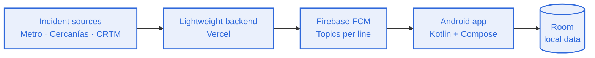

<h1 align="center">TRANZIT · Documentation</h1>

<p align="center">
  <a href="../es/README.md"></a>
  &nbsp;&nbsp;
  <a href="../../README.md"></a>
</p>

---

## Table of contents

- [What is TRANZIT](#what-is-tranzit)
- [Features](#features)
- [How it works](#how-it-works)
- [App screens](#app-screens)
- [Profiles and database](#profiles-and-database)
- [Tech stack](#tech-stack)
- [Getting started](#getting-started)
- [Repository structure](#repository-structure)
- [Project status](#project-status)
- [License](#license)
- [Authors](#authors)

## What is TRANZIT

TRANZIT is a native Android mobile app that helps you anticipate public transport incidents (Metro, Cercanías and CRTM). It alerts the user before they reach the station, so they can change route in time.

## Features

- Incident alerts per line through push notifications.
- Community forum where users report incidents, with Emergency and Information tags.
- Map of stations and incidents.
- NFC card reading and writing (NTAG215) to link the transport pass.
- Profile with statistics, report history and the user's own suggestions.
- Contact and support with a message form and FAQ.

## How it works



1. The backend extracts incident data.
2. It publishes each alert to the topic of its line in Firebase Cloud Messaging.
3. The app, subscribed to the topics of the user's lines, shows the notification.

## App screens

| Screen | Description |
| --- | --- |
| Home | Summary of incidents on the user's lines. |
| Sign up | Sign in with email and password, Google or X. |
| Forum / Community | Incidents reported by users, tagged Emergency or Information. |
| Map | Stations and incidents on the map. |
| Contact and support | Send a message and browse the FAQ. |
| Profile | Statistics, transport pass, link NFC card, my suggestions, report history, notifications and settings. |

## Profiles and database

The database is organized around three profiles:

| Profile | Purpose |
| --- | --- |
| `usuario1` | Regular app user. |
| `usuario2` | Second regular user, to test interaction between users. |
| Administrator | App management and report moderation. |

## Tech stack

| Area | Technology |
| --- | --- |
| Language | Kotlin |
| UI | Jetpack Compose |
| IDE and build | Android Studio, Gradle |
| Notifications | Firebase (FCM Topics) |
| Backend | Vercel |
| Local data | Room |
| Hardware | NFC (NTAG215) |
| CI | GitHub Actions (`build.yml`) |

Infrastructure cost is kept within the Free Tier.

## Getting started

Requirements: a recent Android Studio and an Android device or emulator.

```bash
# clone the repository
git clone https://github.com/ag-hp/tranzit.git
cd tranzit
```

1. Open the project in Android Studio and wait for the Gradle sync to finish.
2. Create your own Firebase project and add the `google-services.json` file to the `app/` folder.
3. Run the app on a device or emulator. Reading NFC cards requires a physical device with NFC.

## Repository structure

```
tranzit/
├── README.md
├── LICENSE
├── docs/
│   ├── assets/
│   ├── en/
│   └── es/
└── .github/
    └── workflows/
        └── build.yml
```

## Project status

Work in progress.

## License

Proprietary software. See the [LICENSE](../../LICENSE) file.

## Authors

- [ag-hp](https://github.com/ag-hp)
- [Second author](#)
