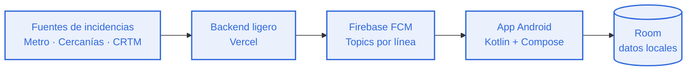

<h1 align="center">TRANZIT · Documentación</h1>

<p align="center">
  <a href="../../README.md"></a>
  &nbsp;&nbsp;
  <a href="../en/README.md"></a>
</p>

<!-- Separador -->
<p align="center">
  
</p>

## Índice

- [Qué es TRANZIT](#qué-es-tranzit)
- [Funcionalidades](#funcionalidades)
- [Cómo funciona](#cómo-funciona)
- [Pantallas de la app](#pantallas-de-la-app)
- [Perfiles y base de datos](#perfiles-y-base-de-datos)
- [Tecnologías](#tecnologías)
- [Puesta en marcha](#puesta-en-marcha)
- [Estructura del repositorio](#estructura-del-repositorio)
- [Estado del proyecto](#estado-del-proyecto)
- [Licencia](#licencia)
- [Autores](#autores)

## Qué es TRANZIT

TRANZIT es una aplicación móvil nativa para Android que ayuda a anticipar las incidencias del transporte público (Metro, Cercanías y CRTM). Avisa al usuario antes de que llegue a la estación, para que pueda cambiar de ruta a tiempo.

## Funcionalidades

- Alertas de incidencias por línea mediante notificaciones push.
- Foro de la comunidad donde los usuarios reportan incidencias, con etiquetas de Emergencia e Información.
- Mapa de estaciones e incidencias.
- Lectura y escritura de tarjetas NFC (NTAG215) para enlazar el abono de transporte.
- Perfil con estadísticas, historial de reportes y sugerencias propias.
- Contacto y soporte con formulario de mensaje y preguntas frecuentes.

## Cómo funciona



1. El backend extrae los datos de incidencias.
2. Publica cada aviso en el topic de su línea en Firebase Cloud Messaging.
3. La app, suscrita a los topics de las líneas del usuario, muestra la notificación.

## Pantallas de la app

| Pantalla | Descripción |
| --- | --- |
| Inicio | Resumen de incidencias de las líneas del usuario. |
| Registro | Acceso con email y contraseña, Google o X. |
| Foro / Comunidad | Incidencias reportadas por usuarios, con etiquetas Emergencia e Información. |
| Mapa | Estaciones e incidencias sobre el mapa. |
| Contacto y soporte | Envío de mensaje y preguntas frecuentes. |
| Perfil | Estadísticas, abono de transporte, enlazar tarjeta NFC, mis sugerencias, historial de reportes, notificaciones y ajustes. |

## Perfiles y base de datos

La base de datos se organiza en torno a tres perfiles:

| Perfil | Uso |
| --- | --- |
| `usuario1` | Usuario normal de la app. |
| `usuario2` | Segundo usuario normal, para probar la interacción entre usuarios. |
| Administrador | Gestión de la app y moderación de reportes. |

## Tecnologías

| Área | Tecnología |
| --- | --- |
| Lenguaje | Kotlin |
| Interfaz | Jetpack Compose |
| IDE y build | Android Studio, Gradle |
| Notificaciones | Firebase (FCM Topics) |
| Backend | Vercel |
| Datos locales | Room |
| Hardware | NFC (NTAG215) |
| CI | GitHub Actions (`build.yml`) |

El coste de la infraestructura se mantiene en el Free Tier.

## Puesta en marcha

Requisitos: Android Studio reciente y un dispositivo o emulador Android.

```bash
# clonar el repositorio
git clone https://github.com/ag-hp/tranzit.git
cd tranzit
```

1. Abre el proyecto en Android Studio y espera a que termine la sincronización de Gradle.
2. Crea tu propio proyecto en Firebase y añade el archivo `google-services.json` en la carpeta `app/`.
3. Ejecuta la app en un dispositivo o emulador. La lectura de tarjetas NFC necesita un dispositivo físico con NFC.

## Estructura del repositorio

```
tranzit/
├── README.md
├── LICENSE
├── docs/
│   ├── assets/
│   ├── en/
│   └── es/
└── .github/
    └── workflows/
        └── build.yml
```

## Estado del proyecto

En proceso.

## Licencia

Software propietario. Consulta el archivo [LICENSE](../../LICENSE).

## Autores

- [ag-hp](https://github.com/ag-hp)
- [Segundo autor](#)
